<div align="center">



[](https://www.kuntze-it.de/)

<br>

[](https://www.kuntze-it.de/)
[](https://www.kuntze-it.de/kontakt/)

**🇩🇪 Deutsch** · [🇬🇧 English](README.en.md)

</div>

<br>

## 👨‍💻 Über mich

```csharp
var lukas = new Developer
{
    Location     = "Leinebergland, Niedersachsen",
    CodingSince  = 2019,
    DayJob       = "Softwareentwickler @ MEDIFOX DAN",
    OwnBusiness  = "Softwareentwicklung & IT-Dienstleistungen Kuntze",
    FocusAreas   = new[] { "Desktop & Mobile", "Web & Portale", "DevOps", "Cloud", "Linux-Server" },
    Industries   = new[] { "Gesundheitswesen", "Feuerwehr & Katastrophenschutz" },
    Principles   = new[] { "Direkt", "Dein Code gehört dir", "Planbar", "Langfristig wartbar" },
    Volunteering = new[]
    {
        "Gemeindeadministrator FF Samtgemeinde Leinebergland",
        "Sachgebietsleiter IuK – Technische Einsatzleitung LK Hildesheim"
    }
};
```

<br>

## 🚀 Was ich baue

<table>
<tr>
<td width="50%">

### 🖥️ Individualsoftware
Fachanwendungen für Desktop & Mobile (iOS/Android), Modernisierung von Bestandssystemen – weg von Excel-Zettelwirtschaft, hin zu echten Lösungen.

</td>
<td width="50%">

### 🌐 Web & Portale
Responsive Webanwendungen, Kunden- & Mitgliederportale mit Rollen- und Rechteverwaltung – barrierearm und datensparsam.

</td>
</tr>
<tr>
<td width="50%">

### ⚙️ Automatisierung & DevOps
Schnittstellen, Datenmigration, Workflow-Automatisierung, CI/CD-Pipelines, Containerisierung.

</td>
<td width="50%">

### ☁️ Infrastruktur & Cloud
Linux- & Windows-Server, Hosting, Backup-Konzepte – lokal, in der Cloud oder hybrid.

</td>
</tr>
<tr>
<td colspan="2" align="center">

### 🚒 Feuerwehr & Katastrophenschutz
Planspiele für die Führungsausbildung · Zusatzalarmierung · Schnittstellen

[](https://feuerwehr-planspiel.demo.kuntze-it.de/)

</td>
</tr>
</table>

<br>

## 🧰 Tech-Stack

<div align="center">


</div>

<br>

## 📊 Stats

<div align="center">

<table>
<tr>
<td align="center" width="50%">


</td>
<td align="center" width="50%">


</td>
</tr>
<tr>
<td align="center" colspan="2">


</td>
</tr>
</table>


</div>

<br>

## 📬 Kontakt

<div align="center">

**Du hast ein Projekt im Kopf?** Vom ersten Konzept bis zur fertigen Fachanwendung – alles aus einer Hand.

Das Erstgespräch ist **kostenlos & unverbindlich**. ☕

[](https://www.kuntze-it.de/)
[](https://www.kuntze-it.de/kontakt/)

<sub>⚡ Ohne Vertrieb, ohne Hotline – du sprichst direkt mit dem Entwickler.</sub>


</div>
